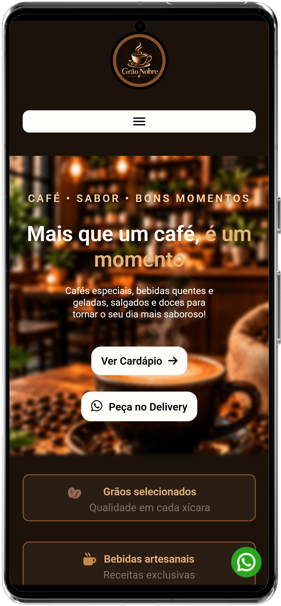
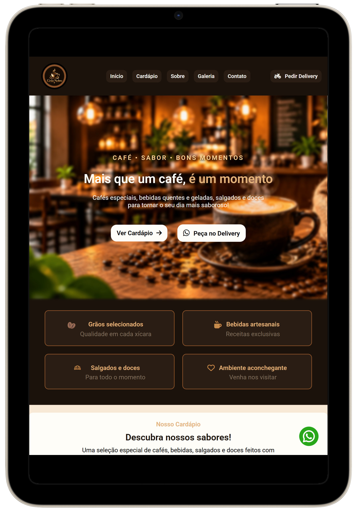
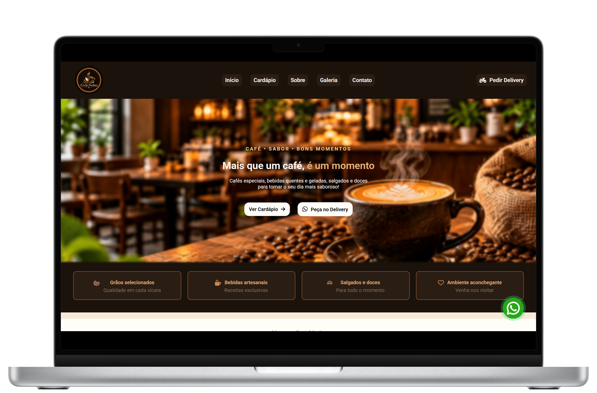
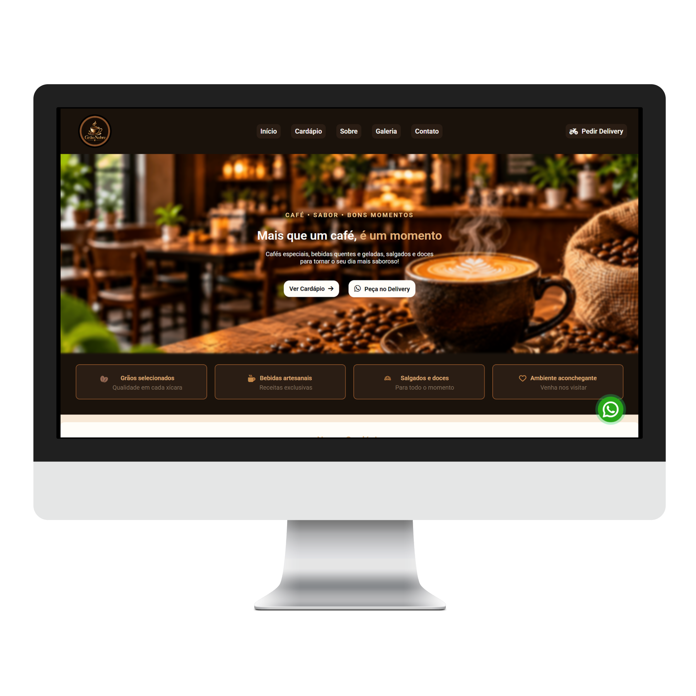
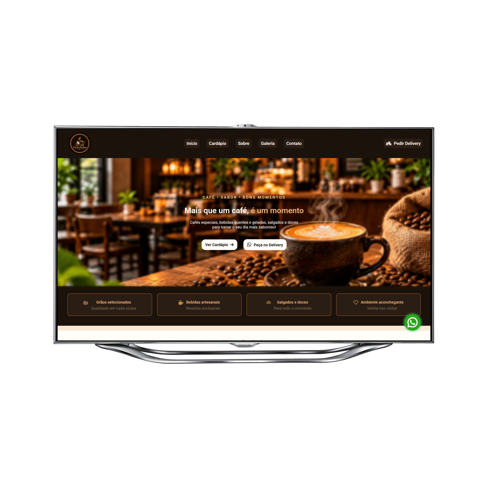

<h1 align="center">🍵 Grão Nobre</h1>

<p align="center">
  Site institucional responsivo para uma cafeteria, desenvolvido com 
             (HTML)
           e 
             (CSS)
          .
</p>

<p align="center">
  <a href="https://idourado7.github.io/Cafeteria/" ><strong>🔗 Ver site online</strong></a>
</p>

---

## 📸 Preview
<div align="center">
 
  &nbsp;&nbsp;
  
</p>
<p/>
<p align="center">
  
  &nbsp;&nbsp;
  
</p>
<p align="center">
    
</p>
</div>
## 📌 Sobre o projeto

O **Grão Nobre** é uma landing page para uma cafeteria fictícia. O objetivo é praticar HTML e CSS, com foco em **responsividade**, organização do código e boas práticas de acessibilidade e SEO.

## ✨ Funcionalidades

- Layout responsivo para celular, tablet, notebook, monitor e TV (2K/4K)
- Menu hambúrguer no mobile e menu horizontal fixo a partir de 768px
- Seções: início, benefícios, cardápio, sobre, galeria, depoimentos e contato
- Botão flutuante de WhatsApp com animação
- Mapa do Google Maps incorporado
- Formulário de newsletter
- Animações e transições suaves, respeitando `prefers-reduced-motion`

## 🛠️ Tecnologias

- **HTML5** semântico
- **CSS3**: Grid, Flexbox, variáveis CSS, CSS aninhado e media queries
- **JavaScript** (apenas o menu mobile)
- **Font Awesome** e **Material Symbols** (ícones)
- **Google Fonts** (Roboto)

## 📱 Responsividade

| Dispositivo | Largura |
|---|---|
| Mobile | até 767px |
| Tablet | a partir de 768px |
| Monitor | a partir de 1280px |
| 2K | a partir de 2560px |
| 4K / TV | a partir de 3840px |

## 🔍 Boas práticas aplicadas

- `loading="lazy"` nas imagens abaixo da dobra
- `meta description` e título descritivo para SEO
- Textos alternativos (`alt`) nas imagens
- Atributos `aria-label` e `aria-hidden` nos ícones

## 🚀 Como executar

```bash
git clone https://github.com/iDourado7/Cafeteria.git
cd Cafeteria
```

Abra o `index.html` no navegador. Não precisa de instalação ou servidor.

## 📂 Estrutura

```
Cafeteria/
├── assets/
├── mockups/
├── index.html
├── mobile.css
├── tablets.css
├── monitor.css
└── 2k-4k.css
```

## 👨‍💻 Autor

Desenvolvido por **Matheus Pires**

[](https://github.com/iDourado7)
<br>
<br>


